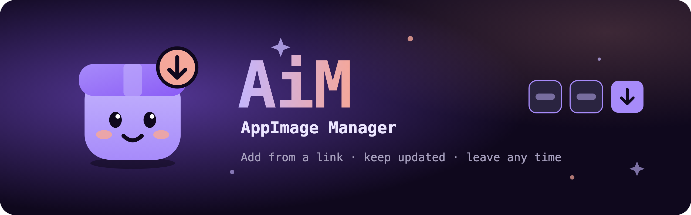

<p align="center">
  
</p>

# AiM: AppImage Manager

AiM installs AppImages from a GitHub repository or a download link, puts them in the application menu with their own icon, and keeps each one updated on its own schedule. You can stop using AiM at any time without breaking the apps it installed.

It comes as two programs; use either or both:

- **`aim`**, the command-line tool. It does everything on its own, and it is all you need if you prefer the terminal.
- **`aim-gui`**, a window and tray icon. It does everything by running `aim`, so it needs `aim` installed next to it (or on your `PATH`).

AiM is built for Arch Linux and CachyOS on x86_64. Other Linux desktops with systemd should work, but aren't tested.

## What it does

- **Add** an app from a GitHub repository, its releases page, a release download link, or any stable download link. AiM downloads it, checks it against the checksum GitHub publishes (when there is one, and tells you when there isn't), puts it in `~/Applications/<app>/`, and writes its menu entry using the AppImage's own name, icon and categories.
- **Keep it updated** daily, weekly, monthly or never, per app, with a systemd timer for each. A new version is installed as soon as it's found, even while the app is open; the open app keeps running the old version, and reopening it gives you the new one.
- **Roll back** to the previous version, and skip releases you don't want.
- **Adopt** AppImages you already have, including working out their version and merging your existing menu entries with the AppImage's.
- **Change** an app's menu name, categories, icon, launch arguments and environment; your changes survive updates.
- **Let go** of one app, or uninstall AiM entirely, leaving every app installed and working.

## Requirements

- Linux on x86_64 with a systemd user session.
- Most AppImages need FUSE 2 to start: `sudo pacman -S fuse2`. `aim doctor` checks for it.
- For `aim-gui`: an X11 or Wayland desktop. Its tray icon needs a StatusNotifierItem tray: KDE Plasma has one; GNOME needs the AppIndicator extension.

## Install

Download the binaries from the repository's **Releases** page. Each release has `aim`, `aim-gui` and a `SHA256SUMS` file.

**Just the command line:**

```sh
sha256sum --check --ignore-missing SHA256SUMS
install -Dm755 aim ~/.local/bin/aim
```

**The window and tray icon too** (put both in the same directory):

```sh
sha256sum --check SHA256SUMS
install -Dm755 aim ~/.local/bin/aim
install -Dm755 aim-gui ~/.local/bin/aim-gui
```

Make sure `~/.local/bin` is on your `PATH`. Nothing else needs installing: `aim` is a single static binary, and `aim-gui` only needs the graphics libraries every desktop already has.

## Quick start

```sh
# Add an app from a repository or a release download link
aim add https://github.com/obsidianmd/obsidian-releases
aim add https://github.com/neovim/neovim/releases/download/v0.12.6/nvim-linux-x86_64.appimage

# See your apps, check for updates, adopt what you already have
aim list
aim update
aim scan

# Or open the window
aim-gui
```

In a terminal, `aim` asks when it needs a decision (which file to install, the app's ID, how to merge menu entries). In scripts, answer with flags instead; `--yes` accepts every suggested answer, and when a question has no suggestion `aim` stops and names the flag that answers it.

## Commands

| Command | What it does |
|---|---|
| `aim add <url>` | Install an AppImage from a GitHub repository, releases page or download link |
| `aim adopt <appimage> <url>` | Let AiM manage an AppImage you already have |
| `aim scan` | Find AppImages AiM doesn't manage yet (in `~/Applications`, `~/Downloads`, `~/.local/bin`, `~/AppImages`) and choose what to do with each |
| `aim ignore <appimage>` | Never offer an AppImage in `scan` again |
| `aim inspect <appimage>` | Show an AppImage's suggested source |
| `aim list` | Show your apps, versions and update checks |
| `aim check [app…]` / `aim update [app…]` | Check for and install updates |
| `aim rollback <app>` | Go back to the previous version and skip the one rolled back from |
| `aim skip <app> [version]` | Don't install a release (the latest by default) |
| `aim unskip <app>` | Allow a skipped release again |
| `aim set-poll <app> <rate>` | Check daily, weekly, monthly or never |
| `aim edit <app> …` | Change the menu name, categories, icon, launch arguments or environment |
| `aim dismiss <app>` | Acknowledge an update (the GUI's "Got it") |
| `aim remove <app>` | Delete an app entirely |
| `aim unmanage <app>` | Stop managing an app; it stays installed and keeps working |
| `aim uninstall` | Stop managing every app and remove AiM itself |
| `aim config` / `aim config set <key> <value>` | Show or change settings |
| `aim doctor` | Look for problems and say how to fix each |
| `aim setup` | Install or repair the timers and menu entries |

`add`, `adopt`, `remove`, `unmanage` and `uninstall` accept `--dry-run` to show what they would do without doing it; other commands refuse it rather than make changes. Every command accepts `--json` for scripts. Run `aim <command> -h` for its flags.

## Settings

Settings live in `~/.config/aim/config.toml`; change them with `aim config set` or in the window's Settings.

| Key | Meaning |
|---|---|
| `default_poll` | How often new apps are checked: `daily`, `weekly` (default), `monthly`, `never` |
| `github_token` | Optional. Without one GitHub allows 60 lookups an hour; with one, 5,000. A token with no permissions is enough. The `GITHUB_TOKEN` environment variable takes precedence. |
| `notify.installed`, `notify.failed`, `notify.digest_mismatch` | Desktop notifications for updates, failed checks, and downloads that didn't match their checksum |
| `tray_autostart` | Start `aim-gui`'s tray icon when you log in |

## Where AiM puts things

| What | Where |
|---|---|
| Apps | `~/Applications/<app>/<app>.AppImage`, its previous version and its icon |
| Menu entries | `~/.local/share/applications/`, named as the app names them, marked with `X-AiM-*` keys |
| Update timers | `~/.config/systemd/user/aim-check@.timer` and one `aim-check@<app>.timer` per app |
| AiM's records | `~/.local/share/aim/` |
| Downloads | `~/.cache/aim/` |

## Leaving AiM

- `aim unmanage <app>` stops managing one app. Its timer and AiM's markers go; the app and its menu entry stay and keep working. You can keep or delete its previous version, and keep its files where they are or move them to `~/Applications/<Name>.AppImage` and the icon theme.
- `aim uninstall` does that for every app, then removes AiM's timers, records, downloads and tray login entry. It always asks whether to keep your settings. It deletes `aim` and `aim-gui` when it can; if a package manager installed them it gives you the command to remove them, and anywhere else it names the files for you to delete.

Both show everything they will change and wait for your confirmation.

## Build from source

You need Go 1.26.3 or newer. `aim` builds anywhere without a C compiler:

```sh
CGO_ENABLED=0 go build -o aim ./cmd/aim
```

`aim-gui` uses [Fyne](https://fyne.io) and needs cgo, so build it on Linux. On Arch or CachyOS, install the packages [Fyne lists](https://docs.fyne.io/started/) plus a C compiler, then build:

```sh
sudo pacman -S --needed go gcc xorg-server-devel libxcursor libxrandr libxinerama libxi wayland libxkbcommon wayland-protocols
go build -o aim-gui ./cmd/aim-gui
```

Run the tests with `go test ./...`.

## Versions and releases

Releases are automatic. Every push to `main` is tested, and if it contains a fix, a feature or a breaking change since the last release, it is tagged with the next [semantic version](https://semver.org), built, and published as a GitHub Release. The version comes from the commit messages, which follow [Conventional Commits](https://www.conventionalcommits.org):

| Commit | Release |
|---|---|
| `fix: …`, `perf: …` | patch: v1.2.**4** |
| `feat: …` | minor: v1.**3**.0 |
| `feat!: …`, or a `BREAKING CHANGE:` footer | major: v**2**.0.0 (a minor while the version is below 1.0) |
| `docs:`, `test:`, `ci:`, `refactor:`, `build:`, `chore:`, `style:` | no release |

The first release is v0.1.0; v1.0.0 is a deliberate step, made by pushing that tag by hand. Pushing any `v*` tag by hand builds and releases it the same way. `aim version` and `aim-gui --version` print the version a binary was built from.

## Design documents

- [`GLOSSARY.md`](GLOSSARY.md): the terms AiM uses
- [`docs/spec.md`](docs/spec.md): what AiM must do, as numbered requirements
- [`docs/adr/`](docs/adr): the decisions behind it and why

## Licence

AiM is released under the [MIT License](LICENSE). JetBrains Mono, bundled in `aim-gui`, is licensed under the SIL Open Font License ([`internal/gui/fonts/OFL.txt`](internal/gui/fonts/OFL.txt)).
